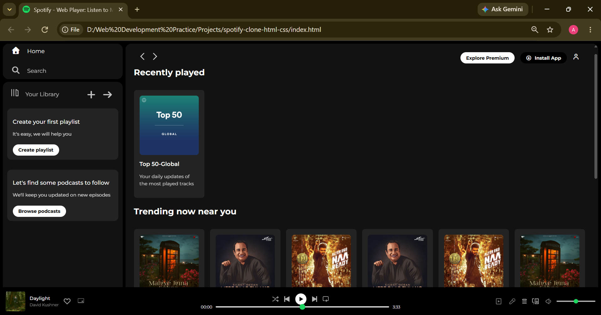
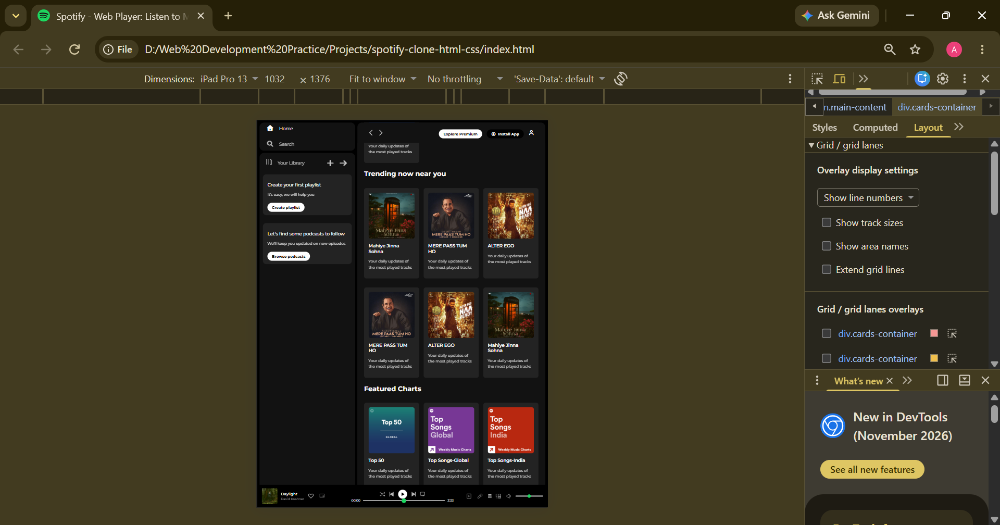
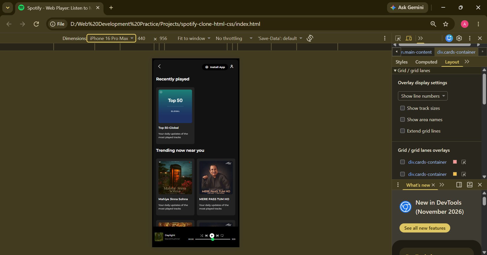

# Spotify Web Player Clone

A responsive frontend recreation of the Spotify Web Player interface, built using HTML5 and CSS3. This project was developed as part of my journey in learning frontend web development.

## Project Preview

### Desktop View



### Tablet View



### Mobile View



## Technologies Used

- HTML5
- CSS3 (Flexbox, CSS Grid, Media Queries)
- Font Awesome
- Google Fonts

## Features

- Spotify-inspired user interface
- Sidebar navigation and library section
- Music and playlist cards
- Music player interface
- Responsive layouts for different screen sizes
- Hover effects and interactive visual elements

## Project Structure

```text
spotify-clone-html-css/
├── assets/
├── screenshots/
│   ├── desktop-preview.png
│   ├── tablet-preview.png
│   └── mobile-preview.png
├── index.html
├── style.css
├── README.md
└── .gitignore
```

## Getting Started

To run this project locally:

1. Clone the repository:
   ```bash
   git clone https://github.com/AaraafAhmad/spotify-clone-html-css.git
   ```
2. Open the project folder.
3. Open `index.html` in your browser. You can also use the Live Server extension in Visual Studio Code.

## Project Scope

This project focuses on the frontend design and layout of a Spotify-inspired web player. It is built with HTML and CSS only. The music player controls and navigation elements are visual UI components; actual music playback and JavaScript-based functionality are not implemented.

## Learning Outcomes

Through this project, I practised:

- Structuring web pages with semantic HTML
- Styling layouts using CSS
- Working with Flexbox and CSS Grid
- Implementing responsive layouts using media queries
- Organizing project files and assets
- Improving frontend development skills through practical implementation

## Disclaimer

This is an independent educational project created for learning and portfolio purposes. It is not affiliated with, endorsed by, or connected to Spotify. Spotify is a trademark of its respective owner. Any third-party assets used in this project remain the property of their respective owners.
